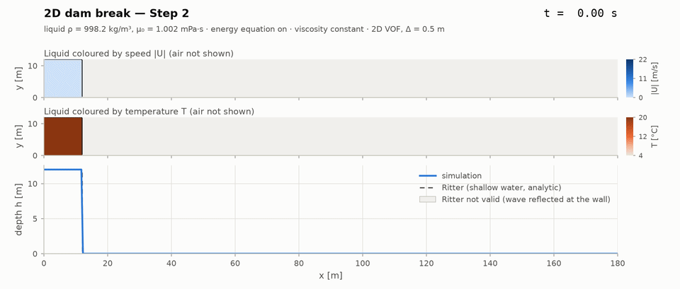

# Boston Molasses Flood 2D — OpenFOAM v2312

2D VOF dam-break of a viscous liquid column that exchanges heat with the
surrounding atmosphere and whose viscosity depends on temperature. The setup
is inspired by the Boston Molasses Disaster (15 January 1919).

Everything runs in Docker; the host only needs `make`, `bash`, `awk` and
Docker Compose v2. Rendering the animations additionally needs
[uv](https://docs.astral.sh/uv/) and `ffmpeg` on the host.



*Step 2 (water, energy equation on), 0–15 s in real time. The heat moves with
the liquid: its mean temperature drops by less than 0.01 K. See
[Animations](#animations) for how to read the panels.*

## Quick start

```bash
make docker-build     # build the OpenFOAM v2312 image (base: opencfd/openfoam-dev:2312)
make run-step1        # builds the solver, mesh and initial fields if needed, then runs
make help             # list all targets
```

`run-stepN` depends on the solver binary, the mesh and the initialised `0/`
as file targets, so a fresh checkout goes from `make run-step4` to results
in one command (after the image is built).

## Make targets

| Target          | Action                                                               |
|-----------------|----------------------------------------------------------------------|
| `docker-build`  | Build the image                                                      |
| `docker-shell`  | Interactive bash in the container (project mounted at `/work`)       |
| `build-solver`  | `wmake solver/interThermalFoam` → `build/bin/interThermalFoam`       |
| `mesh`          | `blockMesh` (360 × 40 × 1 cells)                                     |
| `init`          | Copy `0.orig` → `0`, then `setFields`                                |
| `run-step1..4`  | `scripts/set_step.sh N`, remove previous results, run the solver     |
| `run-anim`      | Copy the inputs to `ANIM_DIR`, set a dense output, run `ANIM_STEP`   |
| `anim`          | Render frames, mp4 and GIF of `ANIM_DIR` (host: uv + ffmpeg)         |
| `readme-gif`    | `anim` + copy the GIF to `docs/media/dambreak-stepN.gif`             |
| `clean`         | Remove time directories, solver logs, `postProcessing/`              |
| `clean-all`     | `clean` + mesh, `0/`, `build/` and wmake objects                     |

Container commands are wrapped as
`docker compose -f docker/docker-compose.yml run --rm -T openfoam ...`,
running as the host UID/GID so that results stay owned by the host user.

`CASE_DIR` can be overridden to keep runs side by side, e.g.

```bash
cp -r case case-step4          # (without results)
make run-step4 CASE_DIR=case-step4
```

## Layout

```text
.
├── Makefile                 # includes make/*.mk, help/clean targets
├── pyproject.toml, uv.lock # Python environment of post/ (uv)
├── make/
│   ├── docker.mk            # compose wrapper, docker-build, docker-shell
│   ├── solver.mk            # build-solver
│   ├── case.mk              # mesh, init, run-step1..4
│   └── post.mk              # run-anim, anim, readme-gif
├── docker/
│   ├── Dockerfile           # opencfd/openfoam-dev:2312 + project overrides
│   ├── docker-compose.yml   # mounts the project root at /work
│   └── entrypoint.sh        # replaces /openfoam/run (see notes)
├── scripts/
│   ├── set_step.sh          # switch transportProperties to step 1..4
│   ├── prepare_anim_case.sh # animation case: copy inputs, set endTime/writeInterval
│   └── clean.sh
├── post/                    # frames and animations (runs on the host)
│   ├── foamio.py            # ASCII field reader, grid from cell centres
│   ├── frames.py            # case metadata, fields of one time step
│   ├── analytic.py          # Ritter solution with the wall reflection
│   ├── plot.py              # panels (flow, temperature, depth, froude), layout
│   └── animate.py           # CLI: frames -> mp4 + GIF
├── docs/media/              # README animation
├── solver/interThermalFoam/
│   ├── Make/{files,options}
│   ├── interThermalFoam.C   # time loop
│   ├── createFields.H       # interFoam fields + T, rhoCp, kappa, muEff
│   ├── TEqn.H               # energy equation
│   ├── updateViscosity.H    # Andrade mu(T), mixture muEff/nuEff
│   ├── UEqn.H, pEqn.H       # laminar momentum with muEff, pressure
│   └── alphaSuSp.H, rhofs.H # hooks required by $FOAM_SOLVERS/multiphase/VoF
└── case/
    ├── 0.orig/              # U, p_rgh, alpha.water, T (pristine)
    ├── constant/            # g, transportProperties
    └── system/              # blockMeshDict, setFieldsDict, controlDict, fvSchemes, fvSolution
```

## Model

Two incompressible immiscible phases (liquid = `water`, `air`), VOF with
MULES interface compression (interFoam v2312), laminar, static mesh.

Energy (mixture, temperature form), properties volume-averaged by `alpha1`:

```text
d(rhoCp T)/dt + div(rhoCp U T) = div(kappa grad T)
rhoCp = alpha1 rho1 Cp1 + (1 - alpha1) rho2 Cp2
kappa = alpha1 kappa1   + (1 - alpha1) kappa2
```

The heat-capacity flux is rebuilt from the MULES mass flux,
`rhoCpPhi = (rhoPhi - rho2 phi)/(rho1 - rho2) (rhoCp1 - rhoCp2) + rhoCp2 phi`,
so it is consistent with the interface advection (also with alpha
sub-cycling). The rhoCp continuity residual is removed implicitly, which keeps
`T` bounded.

Viscosity (Andrade/Arrhenius):

```text
mu1(T) = mu0 exp(B (1/T - 1/T0))       T clipped to [TMin, TMax], mu1 <= muMax
muEff  = alpha1 mu1(T) + (1 - alpha1) mu2
nuEff  = muEff / rho
```

The momentum equation uses `muEff` directly
(`-laplacian(muEff, U) - div(muEff dev2(grad(U)^T))`, the Stokes stress form).
Per PIMPLE iteration: alpha (MULES) → T → mu(T) → U → p_rgh.

### Domain and boundary conditions

x = 0–180 m, y = 0–20 m, z = 0–1 m (1 cell, `empty`), Δx = Δy = 0.5 m.
Liquid block x, y ∈ [0, 12] m at 293.15 K; air at 277.15 K.

| Patch          | U                             | p_rgh                    | alpha.water                | T                                |
|----------------|-------------------------------|--------------------------|----------------------------|----------------------------------|
| `bottom`, `left` (wall) | `fixedValue (0 0 0)` | `fixedFluxPressure`      | `zeroGradient`             | `zeroGradient` (adiabatic)       |
| `right`, `top` (open)   | `pressureInletOutletVelocity` | `totalPressure p0 0` | `inletOutlet 0`       | `inletOutlet 277.15`             |
| `frontAndBack` | `empty`                       | `empty`                  | `empty`                    | `empty`                          |

## Verification steps

| Step | Liquid   | Energy | mu(T) | rho [kg/m³] | mu0 [Pa s] | B [K]  | Cp [J/kg/K] | kappa [W/m/K] |
|------|----------|--------|-------|-------------|------------|--------|-------------|---------------|
| 1    | water    | off    | off   | 998.2       | 1.002e-3   | –      | 4182        | 0.598         |
| 2    | water    | on     | off   | 998.2       | 1.002e-3   | –      | 4182        | 0.598         |
| 3    | water    | on     | on    | 998.2       | 1.002e-3   | 2274   | 4182        | 0.598         |
| 4    | molasses | on     | on    | 1400        | 5.0        | 1.0e4  | 2300        | 0.35          |

`B = 2274 K` reproduces μ_water(4 °C)/μ_water(20 °C) = 1.5673/1.0016 mPa·s.
**The molasses values are placeholders of plausible magnitude**
(B = 1.0e4 K ≈ Ea 83 kJ/mol, μ(4 °C)/μ(20 °C) ≈ 7); replace them with
literature or measured data in `scripts/set_step.sh` before drawing
conclusions. `set_step.sh` edits entries in place, keeps comments and fails
without touching the file if any entry is missing.

## Implementation notes

- **`0.orig` instead of `0`** — `setFields` rewrites `0/` as non-uniform
  lists; keeping the pristine fields in `0.orig` makes `make init` repeatable
  and keeps `0/` out of version control.
- **Own entrypoint** — the upstream `/openfoam/run` sources the OpenFOAM
  environment from `/bin/sh` (dash); the container command leaks into
  `etc/config.sh/setup` as `FOAM_SETTINGS` and fragments of it are `eval`ed
  in `$HOME` before the real command. `docker/entrypoint.sh` clears the
  arguments before sourcing and keeps the nss_wrapper user mapping.
- **Binary location** — `FOAM_USER_APPBIN` is redirected to `build/bin`
  (inside the mount); the default `$HOME/OpenFOAM/...` would vanish with
  `docker compose run --rm`.
- **Solver scope** — laminar only (no turbulence model), static mesh, no LTS,
  no MRF. The VoF headers (`alphaEqn.H`, `alphaEqnSubCycle.H`, …) are taken
  from `$FOAM_SOLVERS/multiphase/VoF` of the installed v2312.
- **`run-stepN` overwrites** the results in `CASE_DIR`; use separate
  `CASE_DIR`s to compare steps.

## Reference runs

OpenFOAM v2312 container on a 16-core Linux host, serial, results on a CIFS
share. Each step: 60 s simulated, ~3,300 time steps, ~110 s wall time,
~30 MB RAM, ~100 MB output (120 compressed time directories).

| Check                                   | Result                                      |
|-----------------------------------------|---------------------------------------------|
| Front speed 3–8 s, water (Step 1)       | ~20.5 m/s (Ritter 2√(gH) = 21.7 m/s)         |
| Front speed 3–8 s, molasses (Step 4)    | ~19 m/s (Re ≈ 7·10⁴: inertia-dominated)      |
| Liquid volume before outflow (~9 s)     | 144.000 m² (= 12 × 12) in all steps          |
| alpha bounds                            | [−1.6e-4, 1 + 1.7e-4]                        |
| T bounds, Steps 2–4                     | [277.15, 293.152] K                          |
| Step 1 vs Step 2 velocity at t = 5 s    | bit-identical (energy is one-way coupled when mu is constant) |

## Animations

```bash
make run-anim                 # Step 2 in case-anim-step2: 0–15 s, written every 0.04 s
make anim                     # -> case-anim-step2/postProcessing/anim/{frames/,animation.mp4,animation.gif}
make readme-gif               # anim + copy the GIF to docs/media/dambreak-step2.gif
make run-anim anim ANIM_STEP=4                                # another step
make anim ANIM_PANELS=flow,depth,froude ANIM_ARGS='--t-max 10' # other panels
```

`run-anim` copies the inputs of `CASE_DIR` into `ANIM_DIR`
(default `case-anim-step$(ANIM_STEP)`), sets `endTime` / `writeInterval`
(`ANIM_END`, `ANIM_WRITE`) and runs `run-stepN` there, so the reference runs
keep their 60 s / 0.5 s output. `anim` writes the cell centres (`0/C`, used to
recover the grid; uniform grids only for now) and calls
`uv run python -m post.animate` (see `--help` for speed, resolution, GIF frame
rate, time range, title). Frames are rendered once at 1920 px; the mp4
(H.264, for slides) plays them in real time at 25 fps, the GIF is the same
frames at 960 px and 12.5 fps (~10 MB budget).

Panels, top to bottom, sharing the x axis:

| Panel         | Shows                                                                            |
|---------------|----------------------------------------------------------------------------------|
| `flow`        | Liquid coloured by speed \|U\|, blended with the air colour by alpha; alpha = 0.5 contour |
| `temperature` | Liquid coloured by T, same blending; alpha = 0.5 contour                         |
| `depth`       | Depth h(x) = Σ alpha Δy against Ritter's shallow-water solution                  |
| `froude`      | Froude number of the depth-averaged flow against Ritter (not in the README GIF)  |

The strips keep the true aspect ratio (no vertical exaggeration) and are
cropped to the initial column height; the depth panel carries the thin-layer
detail.

**Temperature.** In Step 2 the heat is carried by the liquid: in the reference
animation run, 99.5 % of the heat found in cells with alpha < 0.5 belongs to
traces of liquid, and the mean liquid temperature drops by 0.008 K in 15 s
(Pe = UL/a ~ 10⁹). The panel therefore shows a uniform 20 °C liquid, the
advection-only baseline for later runs that resolve interfacial cooling. The
air is hidden on purpose: with one mixture temperature per cell, air that
shared a cell with liquid traces takes the liquid temperature while holding
< 0.1 % of the heat, and the laminar air flow carries it into warm "plumes"
up to ~8 m above the surface. They are a model artefact, not heating of the
atmosphere.

**Ritter's solution** assumes an infinite reservoir. Here the rarefaction
reaches the wall after t₀ = L/c₀ ≈ 1.1 s (L = 12 m, c₀ = √(gH)), and the
reflected wave invalidates the solution behind its head,
x_r = L + 2c₀t − 3L(t/t₀)^(1/3) (≈ 30 m at 3.2 s, ≈ 116 m at 8 s), shaded in
the panel. Beyond x_r the simulated depth follows Ritter; for t ≲ 1 s the
collapse is non-hydrostatic and deviates from shallow-water theory.

## Known limitations

- **Interfacial heat transfer is not resolved at Δ = 0.5 m.** The conductive
  penetration depth √(κ t / ρCp) is ~1 mm (molasses) to ~4 mm (water) after
  one minute, i.e. far below one cell; what exchange there is happens in the
  mixed interface cells. In the reference runs the liquid cells cool by
  < 0.3 K within 60 s and mu(T) changes by < 1 %, so Steps 2–4 verify the
  code path rather than predict cooling. Cooling-driven thickening (minutes
  to hours) needs resolved thermal boundary layers, air-side convection and
  much longer runs.
- **Thin-layer stage under-resolved.** Viscosity matters mostly once the
  layer is thin (h < 1 m = 2 cells); bottom-graded or refined meshes are
  needed there.
- The vertical open boundary (`right`, `p_rgh = 0`) acts as a free overfall;
  fine for the supercritical dam-break front, not for subcritical outflow.
- Air-side convection/turbulence and radiation are not modelled; density is
  independent of temperature.
