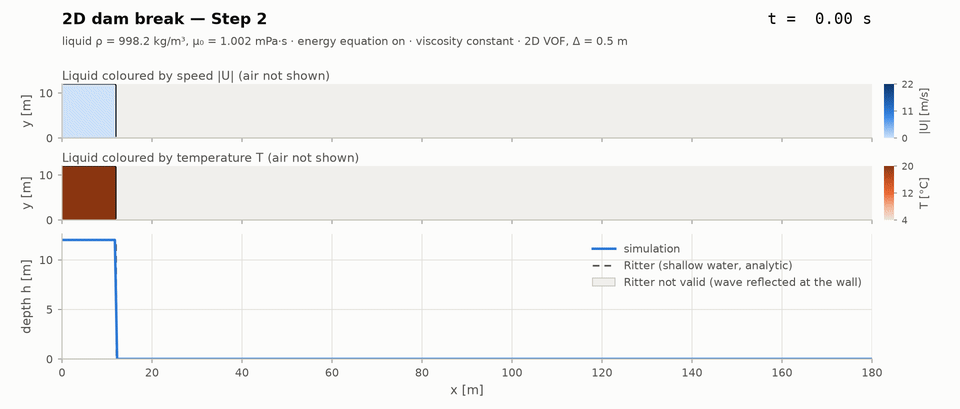
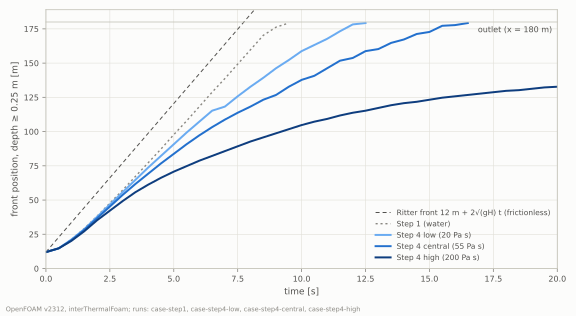
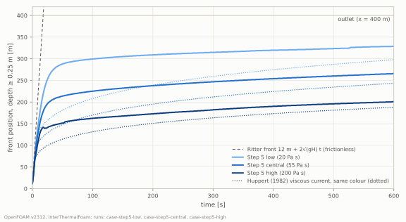
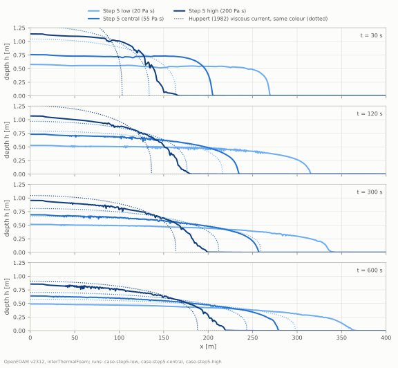

# Boston Molasses Flood 2D — OpenFOAM v2312

2D VOF dam-break of a viscous liquid column that exchanges heat with the
surrounding atmosphere and whose viscosity depends on temperature. The setup
is inspired by the Boston Molasses Disaster (15 January 1919).

Everything runs in Docker; the host only needs `make`, `bash`, `awk` and
Docker Compose v2. Rendering the animations additionally needs
[uv](https://docs.astral.sh/uv/) and `ffmpeg` on the host.



*Step 2 (water, energy equation on), 0–15 s in real time. The heat moves with
the liquid: its mean temperature drops by less than 0.01 K. See
[Animations](#animations) for how to read the panels.*

## Quick start

```bash
make docker-build     # build the OpenFOAM v2312 image (base: opencfd/openfoam-dev:2312)
make run-step1        # builds the solver, mesh and initial fields if needed, then runs
make help             # list all targets
```

`run-stepN` depends on the solver binary as a file target, and rebuilds the
mesh and the initialised `0/` after `set_step.sh` when the step changed them,
so a fresh checkout goes from `make run-step4` to results in one command
(after the image is built).

## Make targets

| Target          | Action                                                               |
|-----------------|----------------------------------------------------------------------|
| `docker-build`  | Build the image                                                      |
| `docker-shell`  | Interactive bash in the container (project mounted at `/work`)       |
| `build-solver`  | `wmake solver/interThermalFoam` → `build/bin/interThermalFoam`       |
| `mesh`          | `blockMesh` (mesh of the last set step, e.g. 360 × 40 × 1 cells)     |
| `init`          | Copy `0.orig` → `0`, then `setFields`                                |
| `run-step1..5`  | `set_step.sh N`, re-`mesh`/`init` if the step changed them, clean, run solver |
| `run-anim`      | Copy the inputs to `ANIM_DIR`, run `ANIM_STEP` there with a dense output |
| `anim`          | Render frames, mp4 and GIF of `ANIM_DIR` (host: uv + ffmpeg)         |
| `readme-gif`    | `anim` + copy the GIF to `docs/media/dambreak-stepN.gif`             |
| `metrics`       | Front, volume, bounds of `METRICS_DIRS` (host: uv)                   |
| `readme-fronts` | Plot the fronts of the reference runs to `docs/media/fronts-step4.svg` |
| `readme-step5`  | Plot the Step 5 fronts and depth profiles to `docs/media/*-step5.svg` |
| `clean`         | Remove time directories, solver logs, `postProcessing/`              |
| `clean-all`     | `clean` + mesh, `0/`, `build/` and wmake objects                     |

Container commands are wrapped as
`docker compose -f docker/docker-compose.yml run --rm -T openfoam ...`,
running as the host UID/GID so that results stay owned by the host user.
If the local file `docker/docker-compose.override.yml` exists, it is added
as a second `-f` (see [Results on another disk](#results-on-another-disk)).

`CASE_DIR` can be overridden to keep runs side by side, e.g.

```bash
cp -r case case-step4          # (without results)
make run-step4 CASE_DIR=case-step4
```

`run-stepN` also takes `MOLASSES_MU` (`low`, `central` or `high`; Steps 4–5),
`MESH_REFINE` (multiplies the cell numbers of the step's mesh, e.g. `2` or
`0.5`; the grading keeps its shape) and `END_TIME` / `WRITE_INTERVAL`
(override the step's `endTime` / `writeInterval` in `system/controlDict`).

### Results on another disk

To keep results on a larger disk (e.g. a NAS), make the `case-*` directory a
symlink before the first run, and mount the symlink's target at the same path
in the container with a local `docker/docker-compose.override.yml`. Keep that
file out of version control (e.g. in `.git/info/exclude`). The Makefile adds
it to every `docker compose` call when it exists, because `docker compose -f`
does not load an override file by itself. The same works for `ANIM_DIR`.

```bash
mkdir -p /mnt/storage/boston-molasses-foam/case-step4
ln -s /mnt/storage/boston-molasses-foam/case-step4 case-step4
cp -rp case/0.orig case/system case/constant case-step4/
make run-step4 CASE_DIR=case-step4
```

```yaml
# docker/docker-compose.override.yml (local only; use absolute paths)
services:
  openfoam:
    volumes:
      - /mnt/storage/boston-molasses-foam:/mnt/storage/boston-molasses-foam
```

## Layout

```text
.
├── Makefile                 # includes make/*.mk, help/clean targets
├── pyproject.toml, uv.lock # Python environment of post/ (uv)
├── make/
│   ├── docker.mk            # compose wrapper, docker-build, docker-shell
│   ├── solver.mk            # build-solver
│   ├── case.mk              # mesh, init, run-step1..5
│   └── post.mk              # run-anim, anim, readme-gif, metrics, readme-fronts, readme-step5
├── docker/
│   ├── Dockerfile           # opencfd/openfoam-dev:2312 + project overrides
│   ├── docker-compose.yml   # mounts the project root at /work
│   └── entrypoint.sh        # replaces /openfoam/run (see notes)
├── scripts/
│   ├── set_step.sh          # switch a case to step 1..5 (properties, liquidT, mesh, run length)
│   ├── prepare_anim_case.sh # animation case: copy the inputs
│   └── clean.sh
├── post/                    # frames and animations (runs on the host)
│   ├── foamio.py            # ASCII field reader, uniform or graded grid from cell centres and points
│   ├── frames.py            # case metadata, fields of one time step
│   ├── analytic.py          # Ritter solution with the wall reflection, Huppert's viscous current
│   ├── plot.py              # panels (flow, temperature, depth, froude), layout
│   ├── animate.py           # CLI: frames -> mp4 + GIF
│   └── metrics.py           # CLI: front, volume, bounds of reference runs; front and depth plots
├── docs/media/              # README animation and figures
├── solver/interThermalFoam/
│   ├── Make/{files,options}
│   ├── interThermalFoam.C   # time loop
│   ├── createFields.H       # interFoam fields + T, rhoCp, kappa, muEff
│   ├── TEqn.H               # energy equation
│   ├── updateViscosity.H    # Andrade mu(T), mixture muEff/nuEff
│   ├── UEqn.H, pEqn.H       # laminar momentum with muEff, pressure
│   └── alphaSuSp.H, rhofs.H # hooks required by $FOAM_SOLVERS/multiphase/VoF
└── case/
    ├── 0.orig/              # U, p_rgh, alpha.water, T (pristine)
    ├── constant/            # g, transportProperties
    └── system/              # blockMeshDict, setFieldsDict, controlDict, fvSchemes, fvSolution
```

## Model

Two incompressible immiscible phases (liquid = `water`, `air`), VOF with
MULES interface compression (interFoam v2312), laminar, static mesh.

Energy (mixture, temperature form), properties volume-averaged by `alpha1`:

```text
d(rhoCp T)/dt + div(rhoCp U T) = div(kappa grad T)
rhoCp = alpha1 rho1 Cp1 + (1 - alpha1) rho2 Cp2
kappa = alpha1 kappa1   + (1 - alpha1) kappa2
```

The heat-capacity flux is rebuilt from the MULES mass flux,
`rhoCpPhi = (rhoPhi - rho2 phi)/(rho1 - rho2) (rhoCp1 - rhoCp2) + rhoCp2 phi`,
so it is consistent with the interface advection (also with alpha
sub-cycling). The rhoCp continuity residual is removed implicitly, which keeps
`T` bounded.

Viscosity (Andrade/Arrhenius):

```text
mu1(T) = mu0 exp(B (1/T - 1/T0))       T clipped to [TMin, TMax], mu1 <= muMax
muEff  = alpha1 mu1(T) + (1 - alpha1) mu2
nuEff  = muEff / rho
```

The momentum equation uses `muEff` directly
(`-laplacian(muEff, U) - div(muEff dev2(grad(U)^T))`, the Stokes stress form).
Per PIMPLE iteration: alpha (MULES) → T → mu(T) → U → p_rgh.

### Domain and boundary conditions

y = 0–20 m, z = 0–1 m (1 cell, `empty`); `set_step.sh` sets the length and
the mesh in `system/blockMeshDict`:

- Steps 1–4: x = 0–180 m, Δx = Δy = 0.5 m (360 × 40 = 14,400 cells).
- Step 5: x = 0–400 m, Δx = 0.5 m; Δy = 0.05 m up to y = 2.5 m, growing by
  ~4.9 % per cell to 0.49 m at y = 12 m, 0.5 m above (800 × 114 = 91,200
  cells). The column top lies on a cell face.

Liquid block x, y ∈ [0, 12] m at `liquidT` = 293.15 K (Steps 1–3) or
283.15 K (Steps 4–5), set per step by `set_step.sh` in
`system/setFieldsDict`; air at 277.15 K.

| Patch          | U                             | p_rgh                    | alpha.water                | T                                |
|----------------|-------------------------------|--------------------------|----------------------------|----------------------------------|
| `bottom`, `left` (wall) | `fixedValue (0 0 0)` | `fixedFluxPressure`      | `zeroGradient`             | `zeroGradient` (adiabatic)       |
| `right`, `top` (open)   | `pressureInletOutletVelocity` | `totalPressure p0 0` | `inletOutlet 0`       | `inletOutlet 277.15`             |
| `frontAndBack` | `empty`                       | `empty`                  | `empty`                    | `empty`                          |

## Verification steps

| Step | Liquid   | Energy | mu(T) | T0 = initial T [K] | rho [kg/m³] | mu0 [Pa s] | B [K]  | Cp [J/kg/K] | kappa [W/m/K] |
|------|----------|--------|-------|--------------------|-------------|------------|--------|-------------|---------------|
| 1    | water    | off    | off   | 293.15             | 998.2       | 1.002e-3   | –      | 4182        | 0.598         |
| 2    | water    | on     | off   | 293.15             | 998.2       | 1.002e-3   | –      | 4182        | 0.598         |
| 3    | water    | on     | on    | 293.15             | 998.2       | 1.002e-3   | 2274   | 4182        | 0.598         |
| 4    | molasses | on     | on    | 283.15             | 1430        | 20/55/200  | 8.5e3  | 2050        | 0.31          |
| 5    | molasses | on     | on    | 283.15             | 1430        | 20/55/200  | 8.5e3  | 2050        | 0.31          |

Steps 1–4 run 20 s, the wave stage, on the 180 m domain. Step 5 runs the
Step 4 molasses for 600 s on the 400 m bottom-refined domain, the spreading
stage (see [Domain](#domain-and-boundary-conditions)).
T0 is the reference temperature of mu0 in mu(T); each step starts the liquid
at T0. `B = 2274 K` reproduces μ_water(4 °C)/μ_water(20 °C) =
1.5673/1.0016 mPa·s.

The molasses values are literature estimates for cane final molasses: no
source describes the 1919 molasses itself. The wiki page
[Molasses properties](https://github.com/s-sasaki-earthsea-wizard/boston-molasses-foam/wiki/Molasses-properties) gives the
derivations, the ranges and what was not verified; the sources are listed
[below](#molasses-property-sources).

- The molasses starts at 10 °C, about 5 °C above the air (Sharp, Kennedy &
  Rubinstein 2016), and mu0 is its viscosity at that temperature.
- mu0 comes from the Broadfoot & Steindl (1980) correlation at a shear rate
  of 10 s⁻¹. It is uncertain by about a factor of 3 either way, mainly
  through the unknown solids content, so Steps 4–5 have three viscosity
  variants, selected with `MOLASSES_MU`: `low` (20 Pa s, 76 % dry
  substance), `central` (55 Pa s, 78 %, the default) and `high` (200 Pa s,
  80 %). All other properties, B included, are the same in the three.
- B = 8.5e3 K (Ea ≈ 71 kJ/mol) reproduces the threefold viscosity increase
  from 10 to 0 °C reported by Sharp et al. (2016).
- rho, Cp and kappa come from sugar-industry correlations at 80 % solids and
  10 °C; sigma (0.075 N/m) has no effect at this mesh.

Run the three variants in separate case directories:

```bash
make run-step4 CASE_DIR=case-step4-low     MOLASSES_MU=low
make run-step4 CASE_DIR=case-step4-central                    # MOLASSES_MU=central
make run-step4 CASE_DIR=case-step4-high    MOLASSES_MU=high
```

Step 5 the same way, with `make run-step5`.

`set_step.sh` records the variant as `viscosityVariant` in
`constant/transportProperties` (`none` in Steps 1–3, which accept only
`central`).

`set_step.sh` edits entries of `constant/transportProperties`,
`system/setFieldsDict`, `system/blockMeshDict` and `system/controlDict` in
place, keeps comments, fails without touching any file if an entry is
missing, and writes a file only when it changes.

### Molasses property sources

- **Viscosity:** Broadfoot, R. & Steindl, R. J. (1980). Solubility –
  crystallisation characteristics of Queensland molasses. *Proc. Int. Soc.
  Sugar Cane Technol.* 17, 2557–2581 (formula as given by Rackemann 2005 and
  Shah 2017). Measurements of final molasses at 30 °C: Shah (2017).
- **Temperature dependence of the viscosity, initial molasses temperature:**
  Sharp, N., Kennedy, J. & Rubinstein, S. (2016). In a sea of sticky
  molasses: The physics of the Boston Molasses Flood. APS Division of Fluid
  Dynamics, abstract L27.00008; American Physical Society press release
  "Molasses Creates a Stick Situation", 21 November 2016.
- **Density, specific heat, thermal conductivity:** Rouillard (1985),
  Janovskii & Archangelskii (1928) as modified by Rouillard (1985), and
  Watson (1986), as given by Rackemann (2005).
- **Air temperature on 15 January 1919:** NOAA Regional Climate Centers,
  Applied Climate Information System (ACIS), threaded record "Boston Area".
- Rackemann, D. W. (2005). *Evaluation of circulation and heat transfer in
  calandria tubes of crystallisation vacuum pans.* Masters (Research) thesis,
  James Cook University. <https://researchonline.jcu.edu.au/1322/>
- Shah, S. (2017). *An investigation into the viscosity of C-massecuite
  using a pipeline viscometer.* MSc Eng thesis, University of KwaZulu-Natal.
  <http://hdl.handle.net/10413/18480>

## Implementation notes

- **`0.orig` instead of `0`** — `setFields` rewrites `0/` as non-uniform
  lists; keeping the pristine fields in `0.orig` makes `make init` repeatable
  and keeps `0/` out of version control.
- **Own entrypoint** — the upstream `/openfoam/run` sources the OpenFOAM
  environment from `/bin/sh` (dash); the container command leaks into
  `etc/config.sh/setup` as `FOAM_SETTINGS` and fragments of it are `eval`ed
  in `$HOME` before the real command. `docker/entrypoint.sh` clears the
  arguments before sourcing and keeps the nss_wrapper user mapping.
- **Binary location** — `FOAM_USER_APPBIN` is redirected to `build/bin`
  (inside the mount); the default `$HOME/OpenFOAM/...` would vanish with
  `docker compose run --rm`.
- **Solver scope** — laminar only (no turbulence model), static mesh, no LTS,
  no MRF. The VoF headers (`alphaEqn.H`, `alphaEqnSubCycle.H`, …) are taken
  from `$FOAM_SOLVERS/multiphase/VoF` of the installed v2312.
- **`run-stepN` overwrites** the results in `CASE_DIR`; use separate
  `CASE_DIR`s to compare steps.
- **Interface compression `cAlpha 0.5`** (`system/fvSolution`) — with
  `cAlpha 1` the thin (1–2 cell), fast (~20 m/s) layer develops surface
  ripples of up to 0.25 m that are numerical. They grow in time and
  travel at u − c, i.e. they excite the layer's gravity waves. Their
  wavelength (~10–20 cells) follows the mesh instead of converging (6–10 m
  at Δ = 0.5 m, 2–3 m at Δ = 0.25 m). With `cAlpha 0.5` they stay below
  0.03 m and decay, while the mean depth profile is unchanged; the interface
  spreads over 2–3 instead of 1–2 cells.

## Reference runs

OpenFOAM v2312 container on a 16-core Linux host, each run serial (all runs
side by side), results on a CIFS share. Steps 1–4 simulate the first 20 s
(`endTime`, set by `set_step.sh`), the wave stage on the 180 m domain: the
fronts of water and of the low and central molasses reach the open end at
x = 180 m after 9.5, 12.5 and 16.5 s, and the layer that follows is only one
or two cells thick (see [Known limitations](#known-limitations)). Per run on
the 0.5 m mesh: 1,300–1,700 time steps, 50–65 s CPU time, ~35 MB output (40
compressed time directories).

The front is the last column whose liquid depth h = Σ α Δy is at least
0.25 m (half a cell). The table and the figure come from `post/metrics.py`:

```bash
make metrics METRICS_DIRS="case-step1 case-step2 case-step3 case-step4-low case-step4-central case-step4-high"
make readme-fronts    # docs/media/fronts-step4.svg from case-step1 and the three Step 4 runs
```



*Front position of the reference runs (0.5 m mesh) against Ritter's
frictionless front. The runs separate after ~3 s; after 20 s the front of the
high-viscosity molasses is at 133 m. The lines end where a front reaches the
outlet.*

| Check                                        | Steps 1–3 (water) | Step 4 low | Step 4 central | Step 4 high |
|----------------------------------------------|-------------------|------------|----------------|-------------|
| Re = √(gH) H / ν₀                            | 1.3·10⁸           | 9.3·10³    | 3.4·10³        | 930         |
| Front speed 3–8 s [m/s] (Ritter: 21.7)       | 20.5              | 15.4       | 12.9           | 8.7         |
| Front at x = 50 / 100 / 150 m [s]            | 3.0 / 5.5 / 8.0   | 3.0 / 6.0 / 9.5 | 3.0 / 6.5 / 11.5 | 3.5 / 9.5 / – |
| Liquid volume until outflow starts [m²]      | 144.000 (9 s)     | 144.000 (9.5 s) | 144.000 (10.5 s) | 144.000 (15 s) |
| Liquid left at 20 s [m²]                     | 80.5              | 109.5      | 134.5          | 143.9       |
| T bounds [K]                                 | [277.15, 293.15] (Steps 2–3) | [277.15, 283.15] | [277.15, 283.15] | [277.15, 283.15] |
| Max cooling of liquid cells (alpha > 0.99) [K] | 4.5·10⁻³ (Steps 2–3) | 3.4·10⁻³ | 5.0·10⁻³    | 1.4·10⁻²    |
| Max first-cell wall shear [Pa]               | 0.07              | 1.3·10³    | 3.3·10³        | 9.9·10³     |

- alpha stays within [−3.9·10⁻⁵, 1 + 4.3·10⁻⁵] in all runs.
- Steps 1–3 give the same front and volume: the energy equation is one-way
  coupled while mu is constant (the Step 1 and Step 2 velocities at t = 5 s
  are bit-identical), and mu(T) changes by 0.01 % in Step 3.
- The volume deviates by at most 1.4·10⁻⁴ m² until liquid reaches the
  outlet column.

**Liquid ahead of the front.** The bottom one or two cells ahead of the
front hold 1–4 % liquid that travels with the air pushed ahead by the
collapse (15–24 m/s just above the layer): a cell has one velocity, so the
liquid in it moves with the air. It adds only 0.02–0.05 m of depth, but a
front taken at h ≥ 0.05 m would run at 17.9 instead of 12.9 m/s for the
central molasses. It shrinks on a 0.25 m mesh (14.1 m/s), so it is
numerical, and the 0.25 m depth threshold leaves it out. It also reaches the
outlet early: the high-viscosity run loses 0.08 m² by 20 s while its front
is at 133 m.

**Mesh study.** Step 4 central on a 0.25 m mesh (720 × 80 cells,
`make run-step4 CASE_DIR=case-step4-central-dx025 MESH_REFINE=2`):

|                                    | 0.5 m (reference) | 0.25 m  |
|------------------------------------|-------------------|---------|
| Front speed 3–8 s [m/s]            | 12.9              | 12.1    |
| Front at x = 50 / 100 / 150 m [s]  | 3.0 / 6.5 / 11.5  | 3.0 / 7.0 / 12.5 |
| Liquid left at 20 s [m²]           | 134.5             | 139.9   |
| Max first-cell wall shear [Pa]     | 3.3·10³           | 6.3·10³ |
| Time steps, CPU time               | 1,454, 56 s       | 2,990, 418 s |

Up to x ≈ 100 m (~7 s) the two meshes agree within one write interval
(0.5 s), and the front speeds within 7 %, well below the spread between the
viscosity variants. Later, as the layer thins to one or two cells, the
arrival times differ by ~10 %, less liquid has left by 20 s, and the wall
shear doubles: that stage is not mesh-converged.

### Step 5: spreading stage

```bash
make run-step5 CASE_DIR=case-step5-low     MOLASSES_MU=low
make run-step5 CASE_DIR=case-step5-central                    # MOLASSES_MU=central
make run-step5 CASE_DIR=case-step5-high    MOLASSES_MU=high
make readme-step5     # docs/media/{fronts,profiles}-step5.svg from these three runs
```

Per run: 20,000–25,000 time steps, 1.6–2.0 h CPU time and 2.9 GB of output
(601 compressed time directories). After 300 s the time step stays at
`maxDeltaT` (0.05 s); before that, air still moving from the collapse
(up to 5 m/s at 60 s) limits it, not the liquid.

The reference is Huppert's (1982) similarity solution for a 2D viscous
current of fixed area A on a no-slip bottom, x_N = 1.411 (g A³ t / 3ν)^(1/5)
(`post/analytic.py`). It holds once the current is long and thin and inertia
is negligible. Its front is compared at the simulated front's depth
threshold, 0.25 m, which its profile reaches 1–4 % behind x_N at 600 s. The
wiki page
[Spreading stage](https://github.com/s-sasaki-earthsea-wizard/boston-molasses-foam/wiki/Spreading-stage)
derives it and discusses the runs in more detail.



*Front position of the Step 5 runs against Ritter's frictionless front and
Huppert's viscous current of the same area, its front also taken at a depth
of 0.25 m (dotted, from 5 s). The wave stage leaves the currents 1.4–1.6
times longer than Huppert's at 30 s; they then creep and approach it from
above.*



*Depth profiles h(x) of the Step 5 runs against Huppert's profiles (dotted).*

| Check                                               | Step 5 low       | Step 5 central   | Step 5 high      |
|-----------------------------------------------------|------------------|------------------|------------------|
| Front speed 3–8 s [m/s] (Step 4, 0.5 m mesh)        | 15.0 (15.4)      | 12.3 (12.9)      | 9.1 (8.7)        |
| Front at t = 30 / 120 / 600 s [m]                   | 266 / 302 / 329  | 202 / 228 / 266  | 144 / 165 / 201  |
| Huppert's front at h = 0.25 m, same times [m]       | 162 / 212 / 285  | 133 / 175 / 238  | 103 / 136 / 186  |
| Front / Huppert's front at t = 120 / 600 s          | 1.42 / 1.15      | 1.31 / 1.12      | 1.21 / 1.08      |
| Growth exponent d ln x / d ln t, 300–600 s; Huppert's front | 0.063; 0.178 | 0.107; 0.188  | 0.138; 0.195     |
| Depth at the wall at 600 s, Huppert [m]             | 0.49, 0.57       | 0.64, 0.70       | 0.86, 0.91       |
| Viscous-film check at 600 s: Re; q / q_lub; τ₁ / (3μū/h) | 0.79; 1.05; 1.02 | 0.42; 1.05; 1.13 | 0.15; 1.24; 1.33 |
| First-cell α under the body at 120 / 600 s          | 0.74 / 0.96      | 0.56 / 0.89      | 0.44 / 0.63      |
| Largest deviation of the liquid area [m²]           | 0.038            | 0.016            | 0.010            |
| Max cooling of liquid cells (alpha > 0.99) [K]      | 0.015            | 0.013            | 0.015            |
| Time steps, CPU time                                | 25,113, 7,158 s  | 21,772, 6,336 s  | 20,345, 5,845 s  |

- alpha stays within [−6.1·10⁻⁶, 1 + 1.7·10⁻⁴]; no liquid reaches the
  outlet in amounts the outflow check counts (alpha > 10⁻³), but traces of
  ~10⁻⁴ leave the low run from ~60 s.
- The first 120 s are identical to those of 120 s runs with the same inputs
  (fields compared at 30 and 120 s).
- The viscous-film check takes the body of the current (h ≥ 0.25 m, at least
  20 m from the wall and the front) and compares its flux and first-cell
  shear with those of a half-parabolic lubrication profile of the same depth
  and mean velocity (medians; `FilmCheck` in `post/metrics.py`).

**Approach to the viscous current.** Up to ~10 s the fronts follow Step 4.
By 30 s the liquid is a nearly flat layer, 0.55–1.1 m deep and 1.4–1.6 times
longer than Huppert's current; from ~60 s on its body is a viscous film
(Re < 2). The current then creeps and its profile approaches the similarity
profile: by 600 s the fronts are 8–15 % ahead of Huppert's front at the same
depth, and the depths at the wall 6–15 % below Huppert's. The fronts still
grow more slowly than his (t^0.06–0.14 against t^0.18–0.20 over 300–600 s)
while the head start from the wave stage decays. Huppert's front with a time
origin shifted by t₀, fitted at 120 s (t₀ = 715, 361 and 202 s), gives 325,
259 and 197 m at 600 s; the runs reach 329, 266 and 201 m.

**Air under the current.** During the wave stage the liquid overruns air at
the bottom: under the body, the first cell (0.05 m) holds about half air from
~5 s on (median alpha 0.34–0.65 at 5 s, 0.44–0.74 at 120 s, i.e. 1.6–3.2 cm
of air). The viscosity is alpha-weighted, so this layer acts as a slip layer:
at 120 s the first-cell shear is 1.3–1.8 times, and the flux up to 1.25
times, that of a viscous film of the same depth. Later the air rises into
the layer as a diffuse mixture (alpha ≈ 0.93–0.99 over the depth), the
bottom is wetted again in the low and central runs, and the ratios approach
1. See [Known limitations](#known-limitations).

**Mesh check.** Step 5 central for 120 s on a mesh with every cell twice as
wide and tall (400 × 57 cells,
`make run-step5 CASE_DIR=case-step5-central-coarse MESH_REFINE=0.5 END_TIME=120`):

|                                         | Step 5 mesh      | `MESH_REFINE=0.5` |
|-----------------------------------------|------------------|-------------------|
| Front speed 3–8 s [m/s]                 | 12.3             | 12.6              |
| Front at t = 30 / 60 / 120 s [m]        | 202 / 217 / 228  | 211 / 224 / 235   |
| Depth at the wall at 120 s [m]          | 0.73             | 0.73              |
| First-cell α, air under the body at 120 s | 0.56, 2.3 cm   | 0.66, 3.5 cm      |
| Time steps, CPU time (120 s)            | 11,542, 2,511 s  | 5,043, 281 s      |

The fronts differ by 3–4 % and the depth at the wall not at all, against a
spread of 165–302 m between the viscosity variants at 120 s.

## Animations

```bash
make run-anim                 # Step 2 in case-anim-step2: 0–15 s, written every 0.04 s
make anim                     # -> case-anim-step2/postProcessing/anim/{frames/,animation.mp4,animation.gif}
make readme-gif               # anim + copy the GIF to docs/media/dambreak-step2.gif
make run-anim anim ANIM_STEP=4                                # another step
make run-anim anim ANIM_STEP=4 MOLASSES_MU=high ANIM_DIR=case-anim-step4-high
make anim ANIM_PANELS=flow,depth,froude ANIM_ARGS='--t-max 10' # other panels
```

`run-anim` copies the inputs of `CASE_DIR` into `ANIM_DIR`
(default `case-anim-step$(ANIM_STEP)`) and runs `run-stepN` there with
`END_TIME` / `WRITE_INTERVAL` set to `ANIM_END` / `ANIM_WRITE`, so the
reference runs keep their own output. `anim` writes the cell centres (`0/C`,
used with the mesh points to recover the grid, uniform or graded) and calls
`uv run python -m post.animate` (see `--help` for speed, resolution, GIF frame
rate, time range, title). Frames are rendered once at 1920 px; the mp4
(H.264, for slides) plays them in real time at 25 fps, the GIF is the same
frames at 960 px and 12.5 fps (~10 MB budget).

Panels, top to bottom, sharing the x axis:

| Panel         | Shows                                                                            |
|---------------|----------------------------------------------------------------------------------|
| `flow`        | Liquid coloured by speed \|U\|, blended with the air colour by alpha; alpha = 0.5 contour |
| `temperature` | Liquid coloured by T, same blending; alpha = 0.5 contour                         |
| `depth`       | Depth h(x) = Σ alpha Δy against Ritter's shallow-water solution                  |
| `froude`      | Froude number of the depth-averaged flow against Ritter (not in the README GIF)  |

The strips keep the true aspect ratio (no vertical exaggeration) and are
cropped to the initial column height; the depth panel carries the thin-layer
detail.

**Temperature.** In Step 2 the heat is carried by the liquid: in the reference
animation run, ≥ 99.5 % of the heat found in cells with alpha < 0.5 belongs to
traces of liquid, and the mean liquid temperature drops by < 0.01 K in 15 s
(Pe = UL/a ~ 10⁹). The panel therefore shows a uniform 20 °C liquid, the
advection-only baseline for later runs that resolve interfacial cooling. The
air is hidden on purpose: with one mixture temperature per cell, air that
shared a cell with liquid traces takes the liquid temperature while holding
< 0.1 % of the heat, and the laminar air flow carries it into warm "plumes"
up to ~8 m above the surface. They are a model artefact, not heating of the
atmosphere.

**Ritter's solution** assumes an infinite reservoir. Here the rarefaction
reaches the wall after t₀ = L/c₀ ≈ 1.1 s (L = 12 m, c₀ = √(gH)), and the
reflected wave invalidates the solution behind its head,
x_r = L + 2c₀t − 3L(t/t₀)^(1/3) (≈ 30 m at 3.2 s, ≈ 116 m at 8 s), shaded in
the panel. Beyond x_r the simulated depth follows Ritter; for t ≲ 1 s the
collapse is non-hydrostatic and deviates from shallow-water theory. Ritter's
solution is frictionless, and so is the water run in practice (see
[Known limitations](#known-limitations)): the agreement does not mean the
front speed or shape is realistic.

## Known limitations

- **Interfacial heat transfer is not resolved at Δ = 0.5 m.** The conductive
  penetration depth √(κ t / ρCp) is ~2.5 mm (molasses) to ~2.9 mm (water)
  after one minute, i.e. far below one cell; what exchange there is happens in the
  mixed interface cells. In the reference runs the liquid cells
  (alpha > 0.99) cool by ≤ 0.014 K within 20 s and mu(T) changes by ≤ 0.15 %, so
  Steps 2–4 verify the code path rather than predict cooling. Step 5 (first
  cell 0.05 m) does not change this: ≤ 0.015 K within 600 s. Cooling-driven thickening (minutes
  to hours) needs resolved thermal boundary layers, air-side convection and
  much longer runs.
- **Bottom friction is effectively absent for water.** The bottom is a
  laminar no-slip wall (no turbulence model, wall function, roughness or
  friction law), so the wall shear is μ u₁ / (Δy/2) with the first-cell
  velocity u₁. In the Step 2 animation run it is ~0.05 Pa, while a Manning
  estimate (n = 0.015) gives ~200–260 Pa at Re = uh/ν ~ 10⁷: the water front
  runs nearly frictionless (front speed 94 % of Ritter's 2√(gH)). For the
  molasses it reaches 1.3, 3.3 and 9.9 kPa (low, central, high), but it
  depends on the mesh (6.3 kPa for the central molasses on a 0.25 m mesh),
  because the laminar boundary layer √(ν t) (~12, 20 and 37 cm after 1 s) is
  not resolved by the 0.5 m cells.
- **Thin-layer stage not resolved in Steps 1–4.** From ~10 s on, the
  molasses layer is one or two cells thick, which is where the viscosity
  matters most and where the 0.5 m mesh is not converged (see the mesh study
  under [Reference runs](#reference-runs)). Steps 1–4 therefore stop at 20 s;
  Step 5 follows the spreading on a bottom-refined mesh and a longer domain.
- **Air trapped under the spreading molasses (Step 5).** The first cell under
  the body of the current holds about half air for the first minutes (see
  [Step 5](#step-5-spreading-stage)). Through the alpha-weighted viscosity it
  lets the current slip at the bottom: at 120 s the flux of the body is up to
  25 % above that of a viscous film. If it acted like a viscosity lower by
  that factor, the front would move ~2–5 % further (x_N ∝ ν^(−1/5)); this is
  an estimate, not a measurement. It is most likely numerical: Step 4 on
  square cells shows no such layer while the current is several cells deep,
  and its thickness depends on the cell size (3.5 cm with a 0.1 m first cell,
  2.3 cm with 0.05 m). The cause has not been traced.
- The vertical open boundary (`right`, `p_rgh = 0`) acts as a free overfall;
  fine for the supercritical dam-break front, not for subcritical outflow.
- Air-side convection/turbulence and radiation are not modelled; density is
  independent of temperature.
